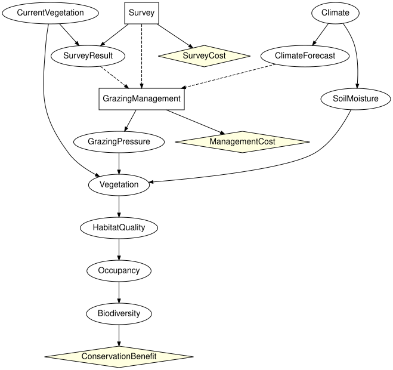

# Should we survey first? Composing a monitoring decision
Simon Frost

- [Overview](#overview)
- [Setup](#setup)
- [Three components](#three-components)
- [The manager cannot read the
  vegetation](#the-manager-cannot-read-the-vegetation)
- [Composing and checking against one large
  diagram](#composing-and-checking-against-one-large-diagram)
- [Pricing survey designs](#pricing-survey-designs)
- [The survey decision in context](#the-survey-decision-in-context)
- [Summary](#summary)
- [References](#references)

## Overview

Vignette 3 priced information about the current vegetation by assuming
it was known exactly. A manager does not get the vegetation; they get a
survey, which costs money and can be wrong. Whether to commission it is
a decision in its own right, taken before the grazing decision and
informing it ([Runge et al. 2011](#ref-Runge2011)). This vignette builds
that two-decision problem from pieces with the open influence diagrams
of `CategoricalInfluenceDiagrams.jl`:

``` text
 site                  monitoring                          grazing
 CurrentVegetation --> Survey (decision) -> SurveyResult --> the grazing diagram of vignette 3,
                       SurveyCost(Survey)                    its decision reading ClimateForecast,
                                                             Survey and SurveyResult
```

The boundary between the monitoring and the grazing component carries
the true vegetation, which drives the ecology, and the survey, which
informs the manager. Only the second is observed. The grazing component
is written once; survey designs of different accuracy and cost are
compared by changing the monitoring component’s numbers only. Every
composite is checked against the same problem built as one influence
diagram.

## Setup

``` julia
using EcologicalBayesianNetworks
using InfluenceDiagrams
using CategoricalInfluenceDiagrams
```

The numbers are those of the zoo’s grazing diagram under the third
valuation of vignette 3: a benefit of 1000 for high biodiversity, and
costs of 51, 25 and 0 for excluding, reducing and maintaining grazing.
Under it the decision is close enough to a tie that the vegetation
matters:

``` julia
g = reference_grazing_id()
k = bind_utility(g, [:ConservationBenefit => [0.0, 1000.0],
                     :ManagementCost => [-51.0, -25.0, 0.0]])
informed = optimize(k).expected_utility
uninformed = optimize(without_information(k, :GrazingManagement, :CurrentVegetation)).expected_utility
(informed = informed, uninformed = uninformed, perfect_survey = informed - uninformed)
```

    (informed = 373.9873744375, uninformed = 373.44730347500007, perfect_survey = 0.5400709624999536)

## Three components

The site holds the prior on the current vegetation and passes it on,
hidden: it is the state of the world, not something anyone has seen.

``` julia
veg = [:sparse, :moderate, :dense]
site = Open(InfluenceDiagram(bayesnet(:CurrentVegetation => veg));
            outputs = [:CurrentVegetation])
println(site)
```

    OpenInfluenceDiagram(1 variables, 1 mechanisms, 0 decisions, 0 utilities; Symbol[] -> [:CurrentVegetation])

The monitoring component takes the vegetation as a hidden input. It
holds the decision `Survey` (survey or skip), with no information of its
own; the survey result, which reports a vegetation class when the survey
is made and `none` otherwise; and the cost of surveying. It passes on
the vegetation, still hidden, and the decision and its result, observed.
`observed` flags each foot separately; here it names the two variables
on the output foot only.

``` julia
results = [:sparse, :moderate, :dense, :none]
monitoring = Open(influence_diagram(:CurrentVegetation => veg, :Survey => [:survey, :skip],
                                    :SurveyResult => results;
                                    mechanisms = [:SurveyResult => (:CurrentVegetation, :Survey)],
                                    decisions = [:Survey => Symbol[]],
                                    utilities = [:SurveyCost => :Survey],
                                    closed = false);
                  inputs = [:CurrentVegetation],
                  outputs = [:CurrentVegetation, :Survey, :SurveyResult],
                  observed = (outputs = [:Survey, :SurveyResult],))
println(monitoring)
```

    OpenInfluenceDiagram(3 variables, 1 mechanisms, 1 decisions, 1 utilities; [:CurrentVegetation] -> [:CurrentVegetation, :Survey!, :SurveyResult!])

The grazing component is the grazing diagram of vignette 3 with the
current vegetation, the survey decision and its result as inputs. Its
decision reads the forecast, as before, and the survey and its result in
place of the vegetation. It reads the survey decision as well as the
result because the composite must have no-forgetting: a later decision
knows what an earlier one chose. `Climate` is given a root mechanism
explicitly, because with `closed = false` a variable without one would
be an input.

``` julia
weather(x) = x => [:dry, :normal, :wet]
variables = [:CurrentVegetation => veg, :Survey => [:survey, :skip], :SurveyResult => results,
             weather(:Climate), weather(:ClimateForecast),
             :SoilMoisture => [:low, :medium, :high],
             :GrazingManagement => [:exclude, :reduce, :maintain],
             :GrazingPressure => [:low, :high], :Vegetation => veg,
             :HabitatQuality => [:poor, :good], :Occupancy => [:absent, :present],
             :Biodiversity => [:low, :high]]
ecology = [:ClimateForecast => :Climate, :SoilMoisture => :Climate,
           :GrazingPressure => :GrazingManagement,
           :Vegetation => (:SoilMoisture, :GrazingPressure, :CurrentVegetation),
           :HabitatQuality => :Vegetation, :Occupancy => :HabitatQuality,
           :Biodiversity => :Occupancy]
grazing_decision = :GrazingManagement => (:ClimateForecast, :Survey, :SurveyResult)
grazing_utilities = [:ConservationBenefit => :Biodiversity,
                     :ManagementCost => :GrazingManagement]
grazing = Open(influence_diagram(variables...;
                                 mechanisms = [:Climate => Symbol[]; ecology],
                                 decisions = [grazing_decision],
                                 utilities = grazing_utilities, closed = false);
               inputs = [:CurrentVegetation, :Survey, :SurveyResult],
               observed = (inputs = [:Survey, :SurveyResult],))
println(grazing)
```

    OpenInfluenceDiagram(12 variables, 8 mechanisms, 1 decisions, 2 utilities; [:CurrentVegetation, :Survey!, :SurveyResult!] -> Symbol[])

## The manager cannot read the vegetation

The boundary says what the grazing decision may use. A grazing component
whose decision reads the vegetation itself is refused when it is opened
with the vegetation hidden (rule 3 of the typed-interface rule):

``` julia
reads_vegetation = influence_diagram(variables[1:3]..., variables[7];
                                     decisions = [:GrazingManagement => (:CurrentVegetation,
                                                                         :Survey, :SurveyResult)],
                                     closed = false)
try
    Open(reads_vegetation; inputs = [:CurrentVegetation, :Survey, :SurveyResult],
         observed = (inputs = [:Survey, :SurveyResult],))
catch e
    sprint(showerror, e)
end
```

    "DiagramInterfaceError: rule 3 (a decision reads only internal or observed input-foot variables) is violated: decision :GrazingManagement has the hidden input :CurrentVegetation in its information set; declare it observed or remove the arc"

Declaring the vegetation observed on the grazing side does not help,
because the monitoring component passes it on hidden, and the two sides
of a boundary must agree:

``` julia
try
    site ⋅ monitoring ⋅ Open(reads_vegetation;
                             inputs = [:CurrentVegetation, :Survey, :SurveyResult],
                             observed = (inputs = [:CurrentVegetation, :Survey, :SurveyResult],))
catch e
    sprint(showerror, e)
end
```

    "ObservabilityMismatchError: compose: outputs(A) vs inputs(B): variable :CurrentVegetation at position 1 is :hidden on the left but :observed on the right; glued interface variables must agree on observability"

A decision that sees the true state has to be written in the monitoring
component, as a survey that is perfect, and then it is priced like any
other survey.

## Composing and checking against one large diagram

The three components compose into a closed influence diagram with two
decisions and three utilities:

``` julia
whole = site ⋅ monitoring ⋅ grazing
println(whole)
```

    OpenInfluenceDiagram(12 variables, 10 mechanisms, 2 decisions, 3 utilities; Symbol[] -> Symbol[])

``` julia
to_graphviz(apex(whole); states = false)
```



The same problem written as one influence diagram, with every arc stated
at once, is the oracle. Its apex is isomorphic to the composite’s:

``` julia
monolithic = influence_diagram(variables...;
                               mechanisms = [:SurveyResult => (:CurrentVegetation, :Survey);
                                             ecology],
                               decisions = [:Survey => Symbol[], grazing_decision],
                               utilities = [:SurveyCost => :Survey; grazing_utilities])
is_isomorphic(apex(whole), monolithic)
```

    true

A survey design is its accuracy, the probability of reporting the true
class (the two wrong classes share the rest equally), and its cost.
`design` binds the zoo’s tables, the survey’s table and the utilities to
the monolithic diagram, and reads off the kernels and utilities that the
composite takes by name:

``` julia
function survey_table(accuracy)
    t = zeros(3, 2, 4)    # (CurrentVegetation, Survey, SurveyResult)
    for v in 1:3, r in 1:3
        t[v, 1, r] = r == v ? accuracy : (1 - accuracy) / 2
    end
    t[:, 2, 4] .= 1.0
    return t
end
chance = [:Climate, :ClimateForecast, :SoilMoisture, :CurrentVegetation, :GrazingPressure,
          :Vegetation, :HabitatQuality, :Occupancy, :Biodiversity]
function design(accuracy, cost)
    m = bind_cpt(InfluenceDiagramModel(monolithic),
                 Pair{Symbol,<:AbstractArray}[[x => cpt(kernel(k, x)) for x in chance];
                                              :SurveyResult => survey_table(accuracy)])
    m = bind_utility(m, [:SurveyCost => [-cost, 0.0], :ConservationBenefit => [0.0, 1000.0],
                         :ManagementCost => [-51.0, -25.0, 0.0]])
    kernels = Dict{Symbol,FiniteKernel}(x => kernel(m, x) for x in [chance; :SurveyResult])
    return m, kernels, Dict{Symbol,AbstractUtility}(bound_utilities(m))
end
nothing # hide
```

A field survey that is right four times in five and costs 0.2:

``` julia
m, kernels, utilities = design(0.8, 0.2)
best = optimize(whole, kernels, utilities)
oracle = optimize(m)
(composite = best.expected_utility, monolithic = oracle.expected_utility,
 same_strategy = best.strategy == oracle.strategy,
 brute_force = expected_utility(m, best.strategy))
```

    (composite = 373.57745744375006, monolithic = 373.57745744375006, same_strategy = true, brute_force = 373.5774574437497)

The last number is the expected utility of the composite’s strategy by
brute force over the joint law of the monolithic model. The survey is
commissioned:

``` julia
policy_table(best.strategy[:Survey])
```

    0-dimensional Array{Symbol, 0}:
    :survey

The grazing policy is a table over the forecast, the survey decision and
the result. On the surveyed slice, rows are the forecast (dry, normal,
wet) and columns the reported vegetation (sparse, moderate, dense,
none); the `none` column is never reached once the survey is made:

``` julia
policy_table(best.strategy[:GrazingManagement])[:, 1, :]
```

    3×4 Matrix{Symbol}:
     :reduce   :exclude  :reduce  :maintain
     :reduce   :exclude  :reduce  :maintain
     :exclude  :exclude  :reduce  :maintain

It is the split vignette 3 found with the vegetation known, now acting
on the report: exclusion where the survey reports moderate vegetation,
and where it reports sparse vegetation under a wet forecast; reduction
elsewhere.

## Pricing survey designs

The value of a survey design is what the composite earns with it, the
survey made free, minus what it earns without it. Changing the design
changes one table and one utility of the monitoring component; the
grazing component and the composite are untouched:

``` julia
value(accuracy) = optimize(whole, design(accuracy, 0.0)[2:3]...).expected_utility - uninformed
accuracies = [1 / 3, 0.5, 0.6, 0.7, 0.8, 0.9, 1.0]
[round(a; digits = 2) => round(value(a); digits = 3) for a in accuracies]
```

    7-element Vector{Pair{Float64, Float64}}:
     0.33 => 0.0
      0.5 => 0.084
      0.6 => 0.151
      0.7 => 0.225
      0.8 => 0.33
      0.9 => 0.435
      1.0 => 0.54

A survey that reports at random (accuracy one third) is worth nothing,
and a perfect one is worth exactly what vignette 3 found for knowing the
vegetation. In between the value falls below the straight line joining
them: a survey right four times in five recovers about 60% of the
perfect-information value where the line would give 70%, and one right
three times in five under 30% where the line would give 40%. That is the
number to set against a quoted survey cost, not the perfect-information
bound.

The value is also the break-even cost. Priced just below it the survey
is commissioned, and just above it it is not:

``` julia
v8 = value(0.8)
[round(c; digits = 3) => policy_table(optimize(whole, design(0.8, c)[2:3]...).strategy[:Survey])
 for c in (v8 - 0.01, v8 + 0.01)]
```

    2-element Vector{Pair{Float64, Array{Symbol, 0}}}:
     0.32 => fill(:survey)
     0.34 => fill(:skip)

## The survey decision in context

The monitoring component is open, so it has no expected utility of its
own. It has one in a context: the law the site induces on the
vegetation, and the value that the grazing component earns from each
joint state of the vegetation, the survey choice and the result. That
value depends on the grazing policy, so the context is fixed by choosing
one. With the grazing policy of the composite’s optimum, the monitoring
component optimised in context commissions the survey and attains the
composite’s optimum:

``` julia
ν = boundary_law(site, kernels, utilities, Strategy())
grazing_value(τ) = continuation_value(grazing, kernels, utilities,
                                      Strategy(:GrazingManagement => τ))
informed_policy = best.strategy[:GrazingManagement]
with_informed = contextual_optimize(monitoring, kernels, utilities; prior = ν,
                                    continuation = grazing_value(informed_policy))
(survey = policy_table(with_informed.strategy[:Survey]),
 value = with_informed.expected_utility,
 matches_composite = with_informed.expected_utility ≈ best.expected_utility)
```

    (survey = fill(:survey), value = 373.57745744375006, matches_composite = true)

A survey is worth only what the manager does differently because of it.
Take instead the grazing policy that is optimal without a survey, which
reads only the forecast, copied across every survey result. It is read
off the composite with the survey priced at 1, above its value, where
the survey is skipped and the result is always `none`. Against it the
survey earns nothing but its cost, and the monitoring component
optimised in context skips it:

``` julia
skipped = optimize(whole, design(0.8, 1.0)[2:3]...)
forecast_only = policy_table(skipped.strategy[:GrazingManagement])[:, 2, 4]
ignoring = DeterministicPolicy(:GrazingManagement,
                               [FiniteAxis(:ClimateForecast, [:dry, :normal, :wet]),
                                FiniteAxis(:Survey, [:survey, :skip]),
                                FiniteAxis(:SurveyResult, results)],
                               FiniteAxis(:GrazingManagement, [:exclude, :reduce, :maintain]),
                               [forecast_only[f] for f in 1:3, s in 1:2, r in 1:4])
c_ignoring = grazing_value(ignoring)
with_ignoring = contextual_optimize(monitoring, kernels, utilities; prior = ν,
                                    continuation = c_ignoring)
surveyed_anyway = contextual_value(monitoring, kernels, utilities,
                                   Strategy(:Survey => ConstantPolicy(:survey));
                                   prior = ν, continuation = c_ignoring)
(survey = policy_table(with_ignoring.strategy[:Survey]),
 skip_value = with_ignoring.expected_utility, uninformed = uninformed,
 surveyed_anyway = surveyed_anyway, uninformed_minus_cost = uninformed - 0.2)
```

    (survey = fill(:skip), skip_value = 373.4473034750002, uninformed = 373.44730347500007, surveyed_anyway = 373.2473034750002, uninformed_minus_cost = 373.2473034750001)

So the survey and the grazing policy cannot be settled one at a time.
Valued against the grazing policy chosen without it, a survey never pays
and is never commissioned; valued against the policy that uses it, it
pays whenever it costs less than about 0.33. The optimum of the
composite is the best pair, which `optimize` finds on the closed
composite, and which the monitoring component attains in context only
once the grazing policy that goes with it is known.

## Summary

The decision to monitor was added to the grazing problem of vignette 3
as a component of its own, between the site and the grazing diagram. The
boundary carries the true vegetation hidden and the survey observed, so
the grazing decision can act only on what the survey reports, and a
component that tried to read the vegetation was refused. The composite
is isomorphic to the problem written as one diagram and agrees with it
on the optimum, the strategy and a brute-force evaluation. Survey
designs were compared by changing the monitoring component’s numbers
alone; an 80% accurate survey is worth about 60% of perfect information,
and that, not the perfect-information bound, is what its price should be
compared with. Optimised in the context the site and the grazing
component induce, the monitoring component commissions the survey when
the grazing policy uses its result, and skips it when the policy ignores
the result, which is why the two decisions are optimised together.

## References

<div id="refs" class="references csl-bib-body hanging-indent">

<div id="ref-Runge2011" class="csl-entry">

Runge, Michael C., Sarah J. Converse, and James E. Lyons. 2011. “Which
Uncertainty? Using Expert Elicitation and Expected Value of Information
to Design an Adaptive Program.” *Biological Conservation* 144 (4):
1214–23. <https://doi.org/10.1016/j.biocon.2010.12.020>.

</div>

</div>
